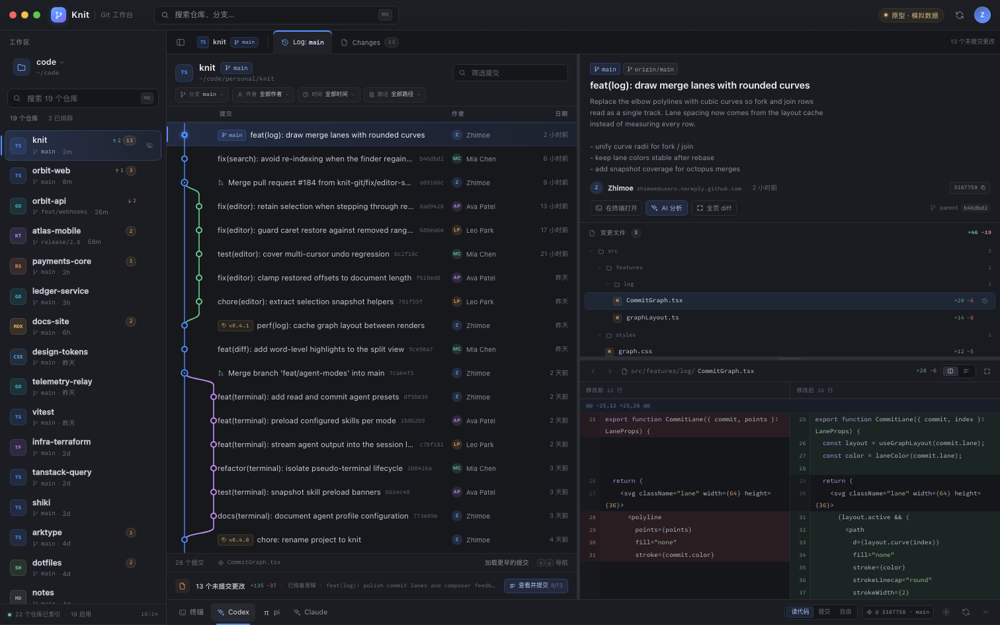
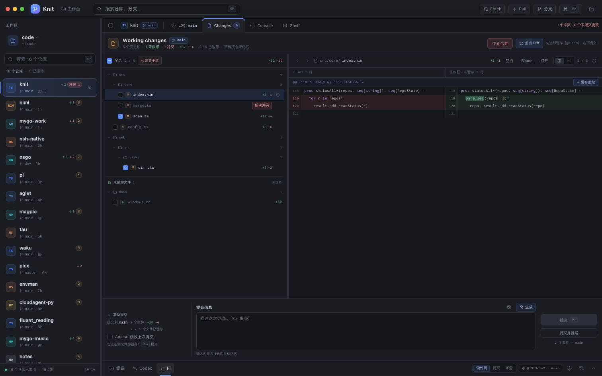
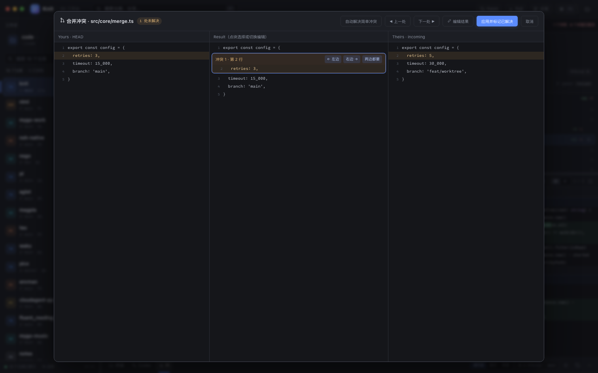

<div align="center">

# knit

**A fast, lightweight multi-repo & multi-agent Git desktop workbench.**

*Point to one workspace root — monitor every repository, review diffs, resolve conflicts, manage branches & worktrees, and collaborate with coding agents in a single native window.*

[](#windows-免安装构建)
[-e0a35c?style=flat-square)](#架构与设计)
[](#架构与设计)
[](#windows-免安装构建)

<br/>



</div>

---

## 为什么做 knit？

当你在本机同时维护 5–30 个仓库，或者让多个 AI coding agent 在不同分支 / worktree 上并行干活时，传统单仓 Git 客户端需要反复切窗口，而重型 IDE 启动慢、内存占用高。

**knit** 用 **Nim + [nimi](https://github.com/zhimoe/nimi)（WebView2）** 作为原生宿主，**纯 TypeScript + 手写 DOM** 绘制界面（零 Electron、零 React、零运行时框架负担），把 JetBrains 级别的 Log / Diff / 合并体验和多仓库、多 Agent 协作收进一个 ~1.6 MB 的轻量客户端里。

## 核心特性

### 1. 多仓库总览工作区
- **根目录自动发现**：选定工作区根目录后自动扫描所有子仓库，增量缓存 `dirMtimes`，支持按目录名规则或单个仓库排除/恢复。
- **实时状态监控**：文件监视 + 8 路并发状态刷新，侧栏一眼看清语言标识、当前分支、领先/落后提交数、未提交改动与冲突数。
- **可折叠侧栏与全套可拖拽面板**：侧栏、Log/详情、文件树/Diff、Changes 文件树、底部终端全部支持拖拽调宽/调高（双击重置，状态自动记忆）。

### 2. JetBrains 风格 Git Log、Diff 与 Changes
- **可视化分支图**：平滑贝塞尔泳道曲线、HEAD/Merge 节点区分、分支/远端/标签胶囊，支持按分支、作者、时间、文件路径与关键词实时筛选，支持游标分页与虚拟滚动。
- **高质量并排 / 统一 Diff**：支持语法高亮与宿主计算的词级差异高亮（UTF-16 CJK 精确对齐）、未变更上下文折叠展开、大文件分块传输（单次 IPC ≤ 256 KB）、忽略空白、逐块暂存（Hunk Staging）与全页面 Diff（`⤢` / 双击文件）。
- **独立 Changes 工作区**：目录树展示已跟踪改动，独立分区展示「未跟踪文件 · 未忽略」，勾选即暂存，支持安全「放弃更改」（自动创建 stash 快照）、按仓库记忆提交草稿、历史提交信息、Amend 与「提交并推送」。

<table>
  <tr>
    <td width="50%">
      
      <p align="center"><sub>独立 Changes 工作区：目录树、未跟踪分区、逐块暂存与草稿记忆</sub></p>
    </td>
    <td width="50%">
      
      <p align="center"><sub>三栏冲突合并：逐块接受左/右/两边，并支持切换自由编辑 Result</sub></p>
    </td>
  </tr>
</table>

### 3. 完整日常 Git 与高级操作
- **分支与远端操作**：`Fetch --all --prune`、`Pull`、`Pull --rebase`、`Checkout`（含远端跟踪检出）、新建分支（可选起点与自动切换）、合并到当前分支、冲突中止（`git merge --abort`）、删除分支（受保护分支拦截 + 未合并二次确认）。
- **可编辑三栏合并器**：`Yours / Result / Theirs` 三栏对照，支持「自动解决简单冲突」、逐块点选，也可一键切换到「编辑结果」直接修改最终内容并实时检测残留冲突标记，应用后自动 `git add`。
- **交互式变基（Rebase -i）**：支持拖拽重排提交与 `pick / reword / squash / fixup / edit / drop`，变基前自动写入 reflog 书签，遇冲突展示「继续 / 跳过 / 中止」横幅。
- **Blame、Worktree / Hand、Shelf、Console 与安全护栏**：逐行按提交着色的 `Blame`（`-M -C`）、独立目录管理的 Worktree（`.knit/hands/`）、不污染 reflog 的 Shelf 补丁箱、500 条环形 Git 命令耗时控制台、以及 `reset --hard` 自动快照与受保护分支禁止 `--force-with-lease`。

### 4. 内置终端与 Agent 协作抽屉
- 底部默认折叠为 38 px 精致页签条（`⌃J` / `Ctrl+J` 切换），内置 **终端 / Codex / Pi** 会话。
- 支持 `读代码 / 提交 / 审查` 模式与按需 Skills 注入，一键根据暂存区 diff 生成提交信息或分析指定 Commit；只读会话自动做工作区快照护栏，若意外变脏支持一键恢复。

---

## 性能实测

| 指标 | 目标预算 | 实测表现 |
| --- | --- | --- |
| 冷启动首帧（54 仓库缓存渲染） | ≤ 300 ms | **106–161 ms** |
| 30 个真实仓库并发 `status`（libgit2 8 路） | ≤ 400 ms | **84.5 ms (P95)** |
| 单仓库 `log`（200 条） | ≤ 60 ms | **28.6 ms (P95)** |
| 根目录增量扫描（54 仓库 / 160 目录） | ≤ 40 ms | **冷扫 4 ms / 热扫 0 ms** |
| Windows 免安装单文件 exe 体积 | ≤ 12 MB | **1.6 MB**（压缩包 748 KB） |

---

## 架构与设计

- **写路径严格走 `git` CLI**：`commit`、`rebase`、`cherry-pick`、`merge`、`push`、`worktree` 等全部调用系统 `git`，完整保留用户的 hooks、凭据管理器与 LFS 行为。
- **读路径支持 libgit2 in-process**：通过 [src/knit/gitlib.nim](src/knit/gitlib.nim) 封装 libgit2（无 libgit2 环境时自动无缝回退到 `git` CLI）。
- **主线程零阻塞**：全部 Git 与文件扫描任务运行在 `bindBackgroundService` 后台池，单次 IPC 载荷严格控制在 256 KB 以内。
- **隐私脱敏日志**：[src/knit/logger.nim](src/knit/logger.nim) 滚动写入脱敏日志，不落盘仓库明文路径、diff 内容或凭据。

详细设计文档见 [`docs/`](docs/)：
- [docs/01-product.md](docs/01-product.md) — 产品范围、用户场景与性能预算
- [docs/03-architecture.md](docs/03-architecture.md) — 宿主架构、线程模型与 IPC 契约
- [docs/04-git-layer.md](docs/04-git-layer.md) — Git 读写分工、命令与安全护栏
- [docs/05-agent.md](docs/05-agent.md) — Agent 抽屉、模式与 Skills 注入
- [docs/06-data-model.md](docs/06-data-model.md) — Wire 类型协议与本地数据目录

---

## 快速开始

### 环境依赖
- [Nim 2.x](https://nim-lang.org/) 与同级目录的 [nimi](https://github.com/zhimoe/nimi)（`../nimi/src`）
- [Bun](https://bun.sh/)（或 Node.js）用于前端打包
- `git`（2.23+）
- 可选：`libgit2`（开启 in-process 读加速）；`zig`（用于在 macOS / Linux 交叉编译 Windows 免安装版）

### 本地开发与运行

```sh
# 1. 构建前端产物（web/dist）
cd web && bun run build && npx tsc --noEmit && cd ..

# 2. 运行桌面端
nim c -r --path:../nimi/src src/main.nim

# 3. 跑完整单元测试套件
nim c -r --hints:off --path:../nimi/src tests/test_all.nim

# 4. 端到端冒烟测试（开窗 → 首帧上报 → 自动退出）
nim c -d:release --hints:off --path:../nimi/src -o:knit src/main.nim
KNIT_WEB=$PWD/web/dist ./knit --smoke
```

### Windows 免安装构建

**方式 A：在 macOS / Linux 上使用 Zig 一键交叉编译绿色免安装版**

```sh
./scripts/build-win-portable.sh amd64
# 产物：
#   dist/knit.exe                  (单文件，内嵌前端与 WebView2Loader.dll)
#   dist/knit-win64-portable/      (绿色目录，含 knit.portable 便携标记)
#   dist/knit-win64-portable.zip   (解压即用压缩包)
```

**方式 B：在 Windows 本机使用 MinGW-w64 构建（支持静态链接 libgit2）**

```powershell
powershell -ExecutionPolicy Bypass -File scripts/build-win.ps1
```

> 同目录存在 `knit.portable` 或 `data/` 时自动进入**便携模式**（所有配置与缓存保存在同级 `data/` 目录，不写入 `%APPDATA%`）。

---

## 快捷键

| 快捷键 | 功能 |
| --- | --- |
| `⌘P` / `Ctrl+P` | 聚焦并搜索仓库（收起侧栏时自动展开） |
| `⌘K` / `Ctrl+K` | 打开命令面板（分支 / Fetch / Pull / Rebase / Reset / Worktree / Force Push） |
| `⌘1` – `⌘4` / `Ctrl+1` – `4` | 切换 `Log` / `Changes` / `Console` / `Shelf` 视图 |
| `⌃J` / `Ctrl+J` | 展开 / 收起底部终端与 Agent 面板 |
| `⌘↵` / `Ctrl+↵` | 在提交框中执行提交 |
| `↑` / `↓` | 在 Log 提交列表中上下导航 |
| `←` / `→` | 在全页面 Diff 中切换上 / 下一个文件 |
| `Esc` | 退出全页面 Diff / Blame / 弹窗 / 气泡 |

---

## 交互原型

项目包含零依赖纯静态交互原型 [`knit-prototype/index.html`](knit-prototype/index.html)，可直接用浏览器打开预览 UI 交互与视觉规范；也提供离线前端夹具 [`web/test/harness.html`](web/test/harness.html) 用于无宿主快速调试与截图回归。
